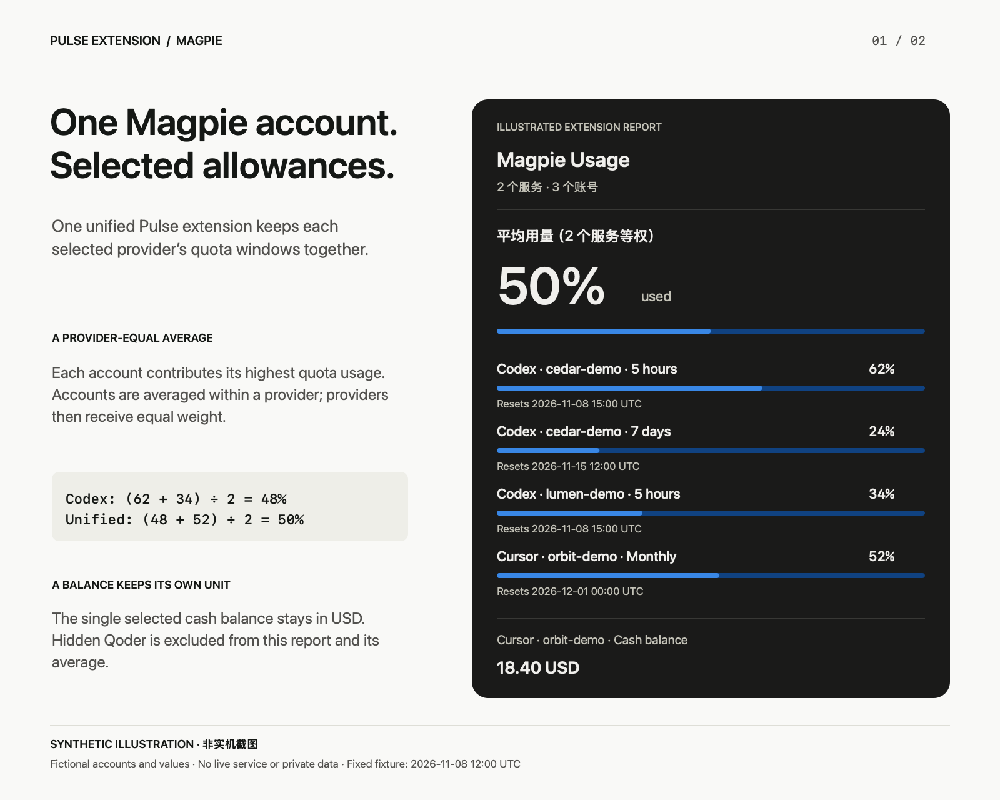
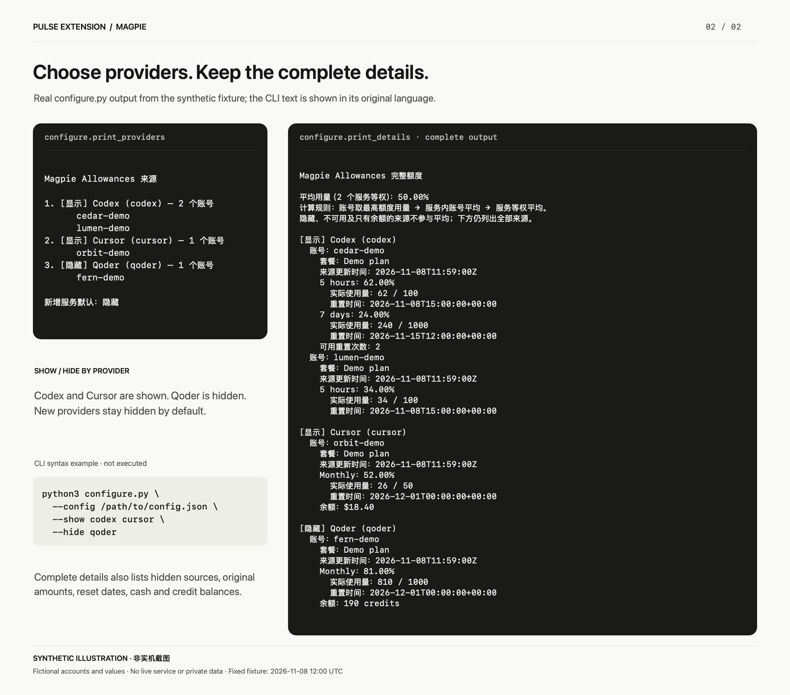

# Magpie → Pulse

[](https://github.com/Jiar/pulse-extension-magpie/actions/workflows/test.yml)
[](LICENSE)

将本机 Magpie Allowances 中的服务、账号和额度集中显示在一个 Pulse 扩展中。支持每个服务的显示开关、自动发现新来源和服务等权平均用量，无需新增 Web 服务、守护进程或 API Key。

扩展显示名为 **Magpie**；Pulse 的用量卡片标题为 **Magpie Usage**。

## 产品效果

一个 **Magpie Usage** 入口集中展示各服务的额度，外层圆环可固定为**服务等权平均用量**，展开后查看各账号的额度窗口与重置时间。


*使用 5 个服务的模拟数据制作的产品效果示意，非 Pulse 实机截图。账号、额度和重置时间均为虚构，摘要与圆环的等权平均用量均为 36%。*

示意图参考定制 Pulse 的卡片布局。本扩展随安装分发 Magpie 图标；显示图标需要 Pulse 支持清单中的可选 `icon` 字段，详见 [Pulse 能力边界](#pulse-能力边界)。模拟数据与图片说明见 [图片说明](docs/images/README.md)。

<details>
<summary>查看合成示意图：统一额度与服务显示开关</summary>

以下示意图同样使用虚构账号、额度和时间，展示统一额度与服务显示开关；示例数据与上方产品图不同。





</details>

## 环境要求

- macOS，安装支持 [schemaVersion 1 扩展](https://github.com/qunqin24/Pulse/blob/main/Docs/extensions.md) 的 Pulse。显示 Magpie 图标还需使用带[扩展图标支持](https://github.com/Jiar/Pulse/tree/feat/extension-icons)的 Pulse 构建。
- Python **3.9 或更新版本**，`python3` 可从 Pulse 的执行环境中找到；无需 pip 依赖。
- Magpie 正在运行，其本地接口可用：`http://127.0.0.1:3425/v1/magpie/quotas`。

Pulse 刷新时启动扩展，扩展读取一次 Magpie，向 stdout 输出一行 JSON 后退出。Magpie 负责向服务商刷新配额；刷新 Pulse 读取的是 Magpie 当前返回的数据。

## 安装与更新

克隆后进入项目目录：

```bash
git clone https://github.com/Jiar/pulse-extension-magpie.git
```

```bash
cd pulse-extension-magpie
```

预览安装操作：

```bash
python3 -B install.py --dry-run
```

执行安装：

```bash
python3 -B install.py
```

安装器只创建一个扩展目录：

```text
~/Library/Application Support/Pulse/Extensions/magpie-allowances/
  pulse-extension.json
  run
  magpie.py
  config.json
  configure.py
  manage.command
  magpie-icon.png
```

在 Pulse 的 **Settings → Manage extensions → Look again** 中发现 **Magpie**，开启 **Show in panel**。然后按下一节将圆环固定到平均用量。

更新代码后重新运行安装命令即可；已有显示开关、新来源默认策略、自定义 endpoint 和时效设置会保留。新增服务或账号无需重装。修改扩展名称、清单或图标后执行 **Look again**。

**显示 Magpie 图标需要同时更新扩展和 Pulse。** 安装器会复制 `magpie-icon.png`，并在清单中写入 `"icon": "magpie-icon.png"`。支持该字段的 Pulse 按扩展账号显示图标；原版或旧版 Pulse 会忽略它，继续显示通用拼图图标，用量读取不受影响。此前发布的 `custom-1.12.7-scroll.1` 只有滚动修复，不包含图标支持；单独重装扩展或重启旧版 Pulse 无法添加这项能力。配套 Pulse 源码与构建说明见 [native-pulse](native-pulse/README.md#扩展图标支持)。

旧版“每账号一个扩展”的目录，经核对为本项目所有后会迁移到项目 `.local/legacy-extensions-<时间>/` 中备份；其他扩展不受影响。`--keep-legacy` 可保留旧目录。

## 平均用量与圆环

平均行的固定 ID 为 `magpie-average`，其后保留各账号的所有有效额度窗口。计算方式：

1. 每个账号取有效额度窗口中的最高消耗百分比。
2. 同一服务的有效账号先求平均。
3. 对参与的服务等权平均。

例如，一个服务的两个账号分别为 80% 和 20%，得到 50%；另一服务为 25%，则总平均为 **37.5%**。窗口或账号较多的服务不会获得更高权重。

隐藏、报错、没有有效额度或只有余额的账号不参与平均。全为 0% 时平均为 0%；超过 100% 时保留原值；无有效额度时不生成平均值。

**Pulse 默认选用量最高的额度。** 要让外层圆环显示平均值，在 Magpie 的账号设置中打开 **Panel → Ring shows**，将 **Highest usage** 改为 **平均用量（N 个服务等权）**。Pulse 内部的固定窗口 ID 为 `extension.magpie-average`，参与服务数量变化不会改变它。

## 服务显示开关

在项目目录运行：

```bash
python3 -B configure.py --list
```

```bash
python3 -B configure.py --hide qoder workbuddy
```

```bash
python3 -B configure.py --show qoder workbuddy
```

让尚未单独配置的新服务默认隐藏：

```bash
python3 -B configure.py --new-providers hide
```

同步来源列表，同时保留已有偏好：

```bash
python3 -B configure.py --sync
```

终端交互菜单：

```bash
python3 -B configure.py --interactive
```

输入服务编号切换显示，`v` 查看完整额度，`r` 同步，`n` 切换新来源默认策略，`q` 退出。也可在 Finder 中双击安装目录内的 `manage.command`。

设置保存在安装目录的 `config.json`，结构见 [config.example.json](config.example.json)：

- `providers`：服务 ID 到布尔值的映射；同一服务的全部账号由同一个开关控制。
- `showNewProviders`：尚未配置的服务默认是否显示。
- `maxAgeSeconds`：默认 `0`，跟随 Magpie 当前数据；正数开启来源数据时效截止。
- `balanceAccount`：可选的主余额账号 ID，见下文。
- `endpoint`：只接受固定路径的 HTTP 字面量回环地址，可自定义端口。

来源消失后不再输出其旧额度，但保留显示偏好。保存后，点击 Pulse 的 Magpie 圆环或等待自动刷新即可生效。

## 查看完整额度

```bash
python3 -B configure.py --details
```

离开项目目录后，可使用已安装的命令：

```bash
python3 -I -B "$HOME/Library/Application Support/Pulse/Extensions/magpie-allowances/configure.py" --details
```

命令读取一次后退出，显示所有来源、账号、有效额度窗口、实际使用量、重置时间、余额和来源更新时间。隐藏来源也会列出并标注，不参与平均；失败或超过时效的账号会明确说明。该命令不修改显示开关，终端可滚动查看全部输出。

## 数据映射与失败处理

- Magpie 的 `windows[].used` 已是百分比；`amount` / `limit` 是实际用量。有有效原始用量而无百分比时使用其比例。
- 额度 ID 包含账号身份。不同账号的同名窗口保持独立，返回顺序变化不会改变不同名称窗口的 ID。
- 保留已知的重置时间和固定窗口长度；不把日历月假定为 30 天。
- `credits` 作为积分指标，不作为货币。余额不会跨账号或币种相加。
- 只有一个显示中的货币余额时自动作为主余额；多个来源时可通过 `python3 -B magpie.py --list` 查找账号 ID，再运行 `python3 -B configure.py --balance-account ACCOUNT_ID`。使用 `--balance-account auto` 恢复自动选择。
- Pulse 最多显示四个附加指标。原始额度窗口不按条数截断；完整余额和重置信息可通过 `--details` 查看。
- 单个账号读取失败不移除其他有效额度；有读数时会报告不可用账号数。
- 来源响应上限为 **2 MiB**，Pulse 输出上限为 **256 KiB**（包含换行）。超过输出上限时返回明确的 `serverError`，不静默丢弃额度行。可关闭不需要的来源以减少输出。

Magpie 未运行时返回 `unreachable`；全部来源隐藏或没有有效额度、货币余额时返回 `noLimits`。Pulse 可能保留上次成功读数并标记过期。要隐藏整个入口，请关闭 **Show in panel**。

## Pulse 能力边界

| 功能 | 实现方式 |
| --- | --- |
| 单个扩展入口、多来源和平均值 | 本扩展直接支持 |
| 服务开关、完整详情 | 本地 JSON 与终端命令 |
| 在 Pulse 设置中嵌入自定义界面 | 扩展协议不支持 |
| 自定义 Magpie 图标 | 安装器分发 PNG 并声明 `icon`；需支持该字段的 Pulse 构建，旧版保持通用图标 |
| 卡片高度、滚动和箭头位置 | 由 Pulse 原生布局决定 |

大量额度的卡片可能受所用 Pulse 版本的原生布局限制。可用 `--details` 查看完整数据；可选的通用“固定摘要＋列表滚动”修复与扩展图标支持见 [native-pulse](native-pulse/README.md)。安装 Python 扩展不会自动更新 Pulse。本仓库提供扩展使用的 PNG，Pulse 源码中的图标加载能力不绑定特定扩展；图标资源的第三方权利说明见 [NOTICE](NOTICE)。

## 隐私与安全

只连接字面量 HTTP 回环地址，包括 IPv6 `::1`；固定路径为 `/v1/magpie/quotas`，拒绝 URL 中的身份信息、查询参数、片段和跳转，禁用系统代理。HTTP 超时 8 秒，扩展执行超时 15 秒。

扩展不读取服务商登录令牌、Cookie、Keychain 或 API Key，也不主动向服务商发请求。账号名称可能出现在 Pulse 和终端输出中；分享截图、日志或问题报告前请替换为虚构数据。项目没有遥测或对外上传功能。更多说明见 [SECURITY.md](SECURITY.md)。

## 开发与验证

```bash
python3 -B -m unittest discover -v
```

测试仅使用合成数据、临时目录和临时回环 HTTP 服务，涵盖映射、平均值、开关、安装后实际执行、迁移及异常输入边界。CI 在 Linux 和 macOS 上运行，覆盖 Python 3.9、3.12、3.14；运行结果见 [GitHub Actions](https://github.com/Jiar/pulse-extension-magpie/actions/workflows/test.yml)。

贡献方式见 [CONTRIBUTING.md](CONTRIBUTING.md)。图片的离线生成方式见 [图片说明](docs/images/README.md)。

## 卸载

在 Pulse 的 Manage extensions 中打开扩展目录，将 `magpie-allowances` 移出 Extensions，再执行 **Look again**。需要保留开关时请先备份其 `config.json`。

## 许可与致谢

本项目采用 [Apache License 2.0](LICENSE)，Copyright 2026 Jiar and contributors。

感谢 [Pulse](https://github.com/qunqin24/Pulse) 提供扩展协议与原生界面，以及 Magpie 提供本地额度来源。附带的 Pulse 补丁保留上游 Apache-2.0 许可和署名，详情见 [NOTICE](NOTICE) 与 [上游许可证](native-pulse/LICENSE-Pulse.txt)。Magpie 图标及第三方商标的权利归各自所有者，项目的 Apache-2.0 许可不授予第三方图像或商标权利。本项目为独立社区集成。
